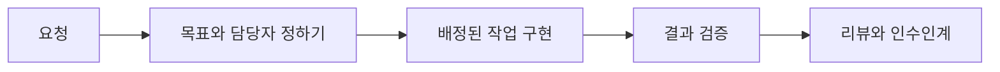

<p align="center">
  
</p>

<h1 align="center">Codexy</h1>

<p align="center">
  Codex가 저장소 작업을 계획하고 구현한 뒤, 검증과 인수인계까지 이어가도록 돕습니다
</p>

<p align="center">
  <a href="README.md">English</a>
</p>

<p align="center">
  <a href="LICENSE"></a>
  <a href="https://github.com/eunsoogi/codexy/commits/main"></a>
  <a href="https://github.com/eunsoogi/codexy/issues"></a>
</p>

Codexy는 Codex가 저장소 작업의 범위를 정하고 담당자를 지정해, 구현 결과를 근거에
따라 검증하도록 돕습니다. 작업 조정, GitHub 작업 안내, 개발 도구를 제공하는 세
가지 플러그인을 포함합니다. 제품과 지원 범위는 연결된 문서에서 확인할 수
있습니다.

## getcodexy로 설치하기

권장 설치 방법은 getcodexy CLI를 사용하는 것입니다.

```sh
uv tool install getcodexy==2.2.0
uv tool update-shell
getcodexy install
```

uv의 tool bin 디렉터리를 PATH에 추가하세요. 설치나 업데이트 뒤에는 새 Codex
세션을 열어 플러그인과 도구를 불러오세요. 기본 설치에는 core, github, devtools가
포함됩니다.

### 컴포넌트 선택

github와 devtools를 설치하면 의존성인 core도 자동으로 포함됩니다.

| 컴포넌트 | 추가 기능                                                                                              | 설치 명령                    |
| -------- | ------------------------------------------------------------------------------------------------------ | ---------------------------- |
| core     | 작업 조정, 전문 에이전트, 검증 안내, Wiki                                                              | `getcodexy install core`     |
| github   | GitHub 작업 흐름 안내와 로컬 Git 안전 확인. 실제 권한은 Codex host, connector, 저장소 설정을 따릅니다. | `getcodexy install github`   |
| devtools | 저장소 탐색과 코드 이동을 위한 Codegraph와 LSP. LSP를 쓰려면 host에 언어 서버가 있어야 합니다.         | `getcodexy install devtools` |

### 자주 쓰는 명령

```sh
getcodexy status
getcodexy doctor
getcodexy update
uv tool upgrade getcodexy==2.2.0
```

`getcodexy status`와 `getcodexy doctor`로 설치 상태를 확인하고,
`getcodexy update`로 설치된 컴포넌트를 갱신할 수 있습니다. `uv tool upgrade`는
CLI 자체를 업데이트합니다.

### 기존 설치 이전

이전하려면 신뢰할 수 있는 Codex 실행 파일을 절대 경로로 지정해야 합니다.

```sh
getcodexy --codex /absolute/path/to/codex migrate
```

정확히 일치하고 수정되지 않은 버전 지정 legacy 설치만 이전할 수 있습니다. 자세한
내용은 [컴포넌트 설치 및 이전 계약](docs/getcodexy-component-installation.md)을
참고하세요.

### 고급 사용: 플러그인 직접 설치

개발 또는 통제된 복구에서만 사용하고 core부터 설치하세요.

```sh
codex plugin marketplace add eunsoogi/codexy --ref v2.2.0
codex plugin add codexy@codexy
codex plugin add codexy-github@codexy
codex plugin add codexy-devtools@codexy
```

MCP 서버는 uv와 uvx로 실행됩니다. Codex를 시작하는 host 환경의 PATH에 둘 다
있어야 합니다.

## Codexy가 제공하는 기능

- **작업 조정.** 목표와 계획을 세우고 이슈 단위 작업의 담당자를 정해 근거를
  인수인계까지 이어갑니다.
- **전문 역할.** Orchestrator는 작업을 배정하고 근거를 확인하며, Worker는 맡은
  작업을 구현하고 검증합니다. Advisor는 범위가 정해진 분석을 제공합니다.
- **검증 안내.** 주장하는 결과에 맞는 확인 방법을 고르고 아직 확인하지 못한
  한계를 드러냅니다.
- **출처 기반 Wiki.** 인용과 최신성 정보를 갖춘 주제별 Wiki를 관리합니다.
- **GitHub 작업 안내.** Codex host, connector, 저장소의 권한과 설정에 따라
  이슈와 pull request 작업을 조정합니다.
- **개발 도구.** Codegraph로 저장소 관계와 변경 영향을 살피고, 사용할 수 있는
  language server가 있으면 LSP로 코드를 탐색합니다. 체크 추천은 참고 정보이며
  실제 체크를 실행하지는 않습니다.

진행 중인 작업에 다른 전문성이 필요하면 Codexy는 Orchestrator가 담당자를 바꾸는
방안을 검토하도록 안내합니다. 실제 작업 담당자는 Codex host가 결정합니다. 자세한
내용은
[Worker 인계 안내](plugins/codexy/skills/orchestration/references/worker-elevation/reconciliation.md)를
참고하세요.

## 작업 흐름



## 지원 환경

Codexy의 패키지 대상에는 macOS ARM64와 Linux x86_64가 포함됩니다. Windows에서
안내하는 지원 범위는 컴포넌트 CLI, 복구, GitHub 활성화입니다. 기존 설치 자동
탐색과 devtools 런타임은 지원 대상으로 안내하지 않습니다. LSP를 사용하려면
Codex를 실행하는 환경에서 language server를 실행할 수 있어야 합니다. 자세한
범위는 [아키텍처 안내서](docs/architecture.md)를 참고하세요.

## 자세한 안내

- [컴포넌트 설치 및 이전](docs/getcodexy-component-installation.md)
- [GitHub 제품 경계](docs/plugin-product-boundary.md)
- [열린 이슈](https://github.com/eunsoogi/codexy/issues)

## 라이선스

Codexy는 [MIT 라이선스](LICENSE)로 제공됩니다.
