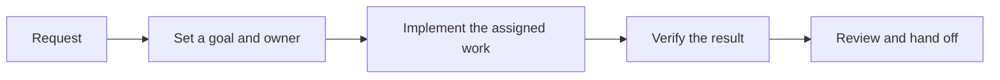

<p align="center">
  
</p>

<h1 align="center">Codexy</h1>

<p align="center">
  A Codex harness for coordinating repository work from planning through implementation, verification, and handoff.
</p>

<p align="center">
  <a href="README.ko.md">Korean</a>
</p>

<p align="center">
  <a href="LICENSE"></a>
  <a href="https://github.com/eunsoogi/codexy/commits/main"></a>
  <a href="https://github.com/eunsoogi/codexy/issues"></a>
</p>

Codexy helps Codex keep repository work scoped, owned, and tied to evidence. It
provides three plugins for task coordination, GitHub workflow context, and
developer tools. Detailed product and support boundaries are in the linked
guides.

## Install with getcodexy

The recommended installation uses the getcodexy CLI:

```sh
uv tool install getcodexy==2.2.2
uv tool update-shell
getcodexy install
```

Add uv's tool bin directory to PATH. After installation or an update, open a
fresh Codex session so it can load the available plugins and tools. The default
install includes core, github, and devtools.

### Choose components

The github and devtools components include core automatically.

| Component | What it adds                                                                                                      | Install command              |
| --------- | ----------------------------------------------------------------------------------------------------------------- | ---------------------------- |
| core      | Task coordination, specialist agents, verification guidance, and Wiki.                                            | `getcodexy install core`     |
| github    | GitHub workflow guidance and local Git safety checks. Host, connector, and repository permissions govern actions. | `getcodexy install github`   |
| devtools  | Codegraph and LSP tools for repository exploration and navigation. LSP requires a language server on the host.    | `getcodexy install devtools` |

### Common commands

```sh
getcodexy status
getcodexy doctor
getcodexy update
uv tool upgrade getcodexy==2.2.2
```

Use `getcodexy status` and `getcodexy doctor` to inspect the installation,
`getcodexy update` to refresh installed components, and `uv tool upgrade` to
update the CLI itself.

### Migrate a legacy installation

Migration requires the trusted Codex executable as an absolute path:

```sh
getcodexy --codex /absolute/path/to/codex migrate
```

Only exact, unmodified, versioned legacy installations are eligible. See the
[component installation and migration contract](docs/getcodexy-component-installation.md)
for details.

### Advanced: install plugins directly

Direct marketplace installation is intended for development or controlled
recovery. Install core first:

```sh
codex plugin marketplace add eunsoogi/codexy --ref v2.2.2
codex plugin add codexy@codexy
codex plugin add codexy-github@codexy
codex plugin add codexy-devtools@codexy
```

The MCP servers use uv and uvx to launch. Both must be on PATH in the host
environment that starts Codex.

## What Codexy offers

- **Task coordination.** Set goals, plans, and clear ownership for issue-sized
  work, then carry relevant evidence through the handoff.
- **Specialist roles.** Orchestrators assign work and check evidence, Workers
  implement and verify assigned tasks, and Advisors provide bounded analysis.
- **Verification guidance.** Choose checks that match the result being claimed
  and keep unresolved limits visible.
- **Source-backed Wiki.** Build a focused topic Wiki with citations and
  freshness information.
- **GitHub workflow guidance.** Coordinate issue and pull request work while
  respecting the permissions of the Codex host, connector, and repository.
- **Developer tools.** Use Codegraph for repository relationships and change
  impact, and LSP for language-aware navigation when a compatible server is
  available. Check recommendations are advisory; they do not run checks.

When an active task needs different expertise, Codexy guides the Orchestrator in
deciding whether another Worker should take over. The Codex host determines who
owns the active task. See the
[Worker handoff guidance](plugins/codexy/skills/orchestration/references/worker-elevation/reconciliation.md).

Use `$planning` to create or update a plan. `planning` owns plan content,
`orchestration` owns execution coordination, and `engineering` owns individual
implementation and verification. `plan-stress-test` is an opt-in plan review,
not an automatic review stage.

## How work flows



## Supported environments

Codexy's packaged plugin targets include macOS ARM64 and Linux x86_64. On
Windows, the documented coverage includes the component CLI, recovery, and
GitHub activation; automatic legacy discovery and the packaged devtools runtime
are not claimed. Each LSP language server must be installed and executable in
the Codex host environment. See the [architecture guide](docs/architecture.md)
for current support boundaries.

## More information

- [Component installation and migration](docs/getcodexy-component-installation.md)
- [GitHub product boundary](docs/plugin-product-boundary.md)
- [Open issues](https://github.com/eunsoogi/codexy/issues)

## Skill inventory

The packaged plugins include these reusable skills. Each link opens its guide.

| Skill                                                                             | Purpose                                   | Component  |
| --------------------------------------------------------------------------------- | ----------------------------------------- | ---------- |
| [agents-md-authoring](plugins/codexy/skills/agents-md-authoring/SKILL.md)         | Create and scope repository instructions. | `core`     |
| [blind-read](plugins/codexy/skills/blind-read/SKILL.md)                           | Interpret one artifact for a reader.      | `core`     |
| [decision-rationale](plugins/codexy/skills/decision-rationale/SKILL.md)           | Inspect a decision's rationale.           | `core`     |
| [engineering](plugins/codexy/skills/engineering/SKILL.md)                         | Implement and verify one issue.           | `core`     |
| [frame-alternatives](plugins/codexy/skills/frame-alternatives/SKILL.md)           | Compare credible options.                 | `core`     |
| [goal-lifecycle](plugins/codexy/skills/goal-lifecycle/SKILL.md)                   | Manage authorized task goals.             | `core`     |
| [orchestration](plugins/codexy/skills/orchestration/SKILL.md)                     | Coordinate ownership and handoffs.        | `core`     |
| [plan-stress-test](plugins/codexy/skills/plan-stress-test/SKILL.md)               | Challenge a plan when requested.          | `core`     |
| [planning](plugins/codexy/skills/planning/SKILL.md)                               | Create or update project plans.           | `core`     |
| [project-brief](plugins/codexy/skills/project-brief/SKILL.md)                     | Summarize recorded project state.         | `core`     |
| [proof-driven-completion](plugins/codexy/skills/proof-driven-completion/SKILL.md) | Match outcome claims to proof.            | `core`     |
| [prune-artifact-claims](plugins/codexy/skills/prune-artifact-claims/SKILL.md)     | Refresh claims against a source.          | `core`     |
| [self-improvement](plugins/codexy/skills/self-improvement/SKILL.md)               | Recover tasks and improve using evidence. | `core`     |
| [git-workflow](plugins/codexy-github/skills/git-workflow/SKILL.md)                | Manage GitHub issue and PR workflows.     | `github`   |
| [codegraph](plugins/codexy-devtools/skills/codegraph/SKILL.md)                    | Explore structure and dependencies.       | `devtools` |
| [lsp](plugins/codexy-devtools/skills/lsp/SKILL.md)                                | Navigate code with language servers.      | `devtools` |

## License

Codexy is available under the [MIT License](LICENSE).
